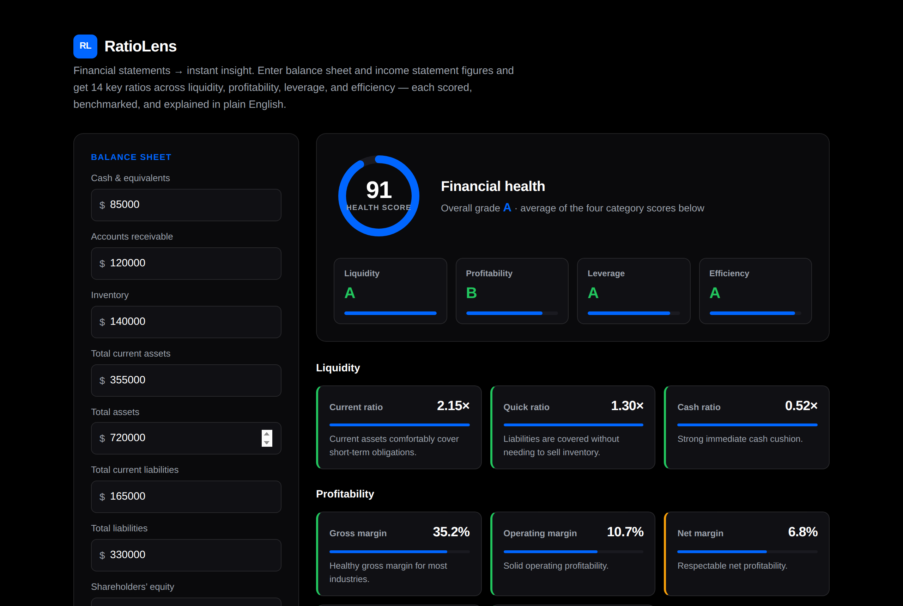

# RatioLens — Financial Statement Analyzer

Type in balance sheet and income statement figures and get an **instant ratio dashboard**: 14 key ratios across liquidity, profitability, leverage, and efficiency — each one scored against benchmarks, graded, and explained in plain English, with an overall financial health score on a live gauge.

**[Live demo →](https://noahbulbring.github.io/ratiolens/)** — click *"Load sample company"* to see a full analysis instantly.



## What it computes

| Category | Ratios |
|---|---|
| **Liquidity** | Current ratio · Quick ratio · Cash ratio |
| **Profitability** | Gross margin · Operating margin · Net margin · Return on equity · Return on assets |
| **Leverage** | Debt-to-equity · Debt ratio · Interest coverage |
| **Efficiency** | Asset turnover · Inventory turnover · Days sales outstanding |

Every ratio card shows the value, a benchmark meter, a green/amber/red status, and a one-line interpretation of what the number actually means for the business. Category grades (A–F) roll up into a single 0–100 health score.

## Features

- **Live recalculation** — the whole dashboard updates on every keystroke
- **Plain-English insights** — interpretations change with the numbers, not generic tooltips
- **Sample company** — one click loads a realistic small distribution business
- **Zero dependencies, fully client-side** — plain HTML/CSS/JS; your financials never leave the browser

## Run locally

```bash
git clone https://github.com/NoahBulbring/ratiolens.git
cd ratiolens
open index.html
```

Run the engine tests with Node:

```bash
node test.js
```

## Disclaimer

Benchmark bands are general-purpose heuristics — healthy values differ meaningfully by industry (a grocer's margins are not a SaaS company's). Not financial advice.

## Build prompt

This project was built end-to-end by an AI agent from this prompt:

> Build a financial statement analyzer: enter balance sheet + income statement figures, get an instant ratio dashboard (liquidity, profitability, leverage, efficiency) with a health score and plain-English interpretations.

## License

MIT © Noah Bulbring
